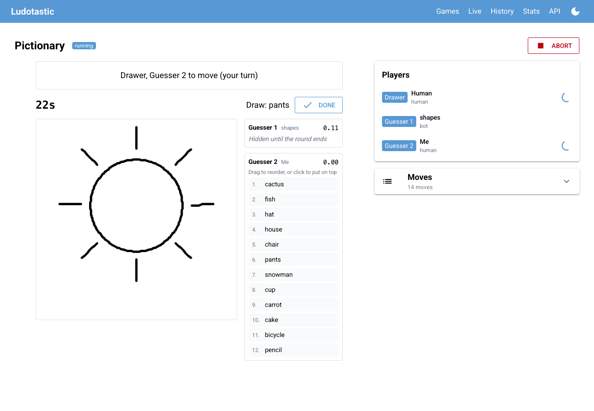
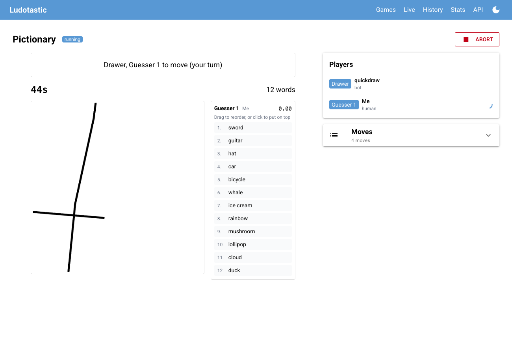

# Pictionary: live guessing, ranked

This note describes the bundled Pictionary game in
`src/ludotastic/games/pictionary/`: how a round works, how guessers are scored,
and how people, decision models such as Jev, and language models each guess.



## The game

Seat 0 is the **Drawer**; every other seat is a **Guesser** (2 to 5 players).

- Each round, 12 words are picked at random from a set of 79 easy-to-draw
  words, all [Quick, Draw!](https://quickdraw.withgoogle.com/data) categories.
  Everybody sees them; only the drawer is told which one is the answer.
- The drawer draws strokes on a 256-unit square, as in Quick, Draw!, and presses
  **Done**, or the round ends after 60 seconds.
- Every guesser keeps **all the words in order, likeliest first**, and can
  change the order at any time while the drawing grows.

Pictionary is a [live][ludotastic.Timing.LIVE] game: nobody waits for anybody.
A stroke or a new order is applied the moment it arrives.

## Scoring

A guesser scores the average, over the round, of **1 over where the answer sat
in their order**. That is 1 for having it on top the whole round, 0.5 for having
it second, and nothing before ranking at all. Getting it early and staying sure
both pay; flipping through guesses does not.

The drawer scores the guessers' average, so the drawer is rewarded for drawing
in a way everybody gets.

## How each kind of guesser plays

| Guesser | How it ranks | How often |
|---|---|---|
| Person | Drags words up and down, or clicks one to put it on top | Whenever they like |
| Decision model (`typesafe:jev-latest@rank`) | One pick-one question over the words; its probabilities give the whole order | After every stroke, with no minimum gap |
| Language model (`openai:...@rank`) | Writes the whole order out, retried until it lists every word once | After a stroke, at most every 2 seconds |

AI guessers see the drawing as a picture (the default view), with the word list
as text. Only image-capable models can guess. A decision model's latest
probabilities are drawn as bars behind each word, so you can watch it change its
mind stroke by stroke.

Only guessers can be AI players (`Game.ai_seats`): the new-match form offers no AI
for the drawer, and the API refuses one. The drawer is a person or a bot.

- `quickdraw` redraws a real person's sketch of the word, one stroke a second,
  then leaves the guessers the rest of the round. Which sketch it picks follows
  the match's seed, so a Jev-versus-language-model match with nobody drawing can
  be repeated exactly.
- `shapes` draws four simple shapes whatever the word, so it only serves as a
  baseline.



### The sketches

The `quickdraw` bot's sketches come from Google's
[Quick, Draw! dataset](https://github.com/googlecreativelab/quickdraw-dataset),
made available by Google under the
[Creative Commons Attribution 4.0 International license](https://creativecommons.org/licenses/by/4.0/).
Ludotastic bundles 5 sketches of each word, about 140 KB, in
`src/ludotastic/games/pictionary/sketches.json`. They are the first drawings
in each category's simplified data that Quick, Draw! recognized and that have at
most 20 strokes. They are otherwise unchanged, apart from being thinned to at
most 200 points a stroke.

To fetch them again, for example after changing the words:

```bash
uv run python scripts/fetch_quickdraw.py
```

## Fair play

While a person is guessing, the other guessers' orders are hidden until the
round ends, and the move list only says that a guesser reordered the words,
never which words.

## Running it

```bash
uv run ludotastic serve   # then Games, Pictionary
```

Pick yourself or the `quickdraw` bot as the drawer, and Jev and a language model
as guessers. With the bot drawing, it also runs without the UI:

```bash
uv run ludotastic play pictionary bot:quickdraw typesafe:jev-latest openai:gpt-6.1-sol --no-swap
```
